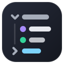
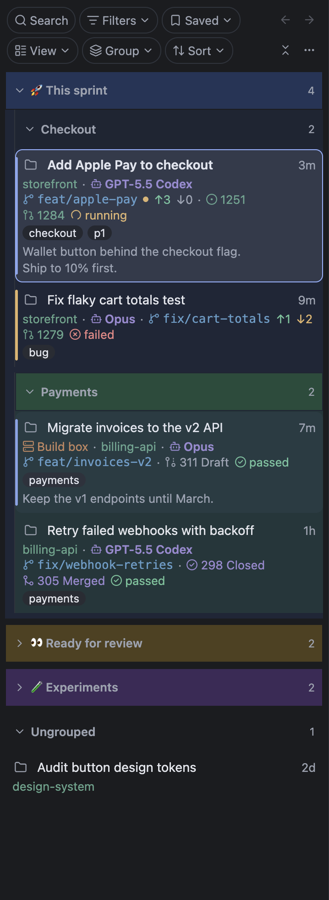
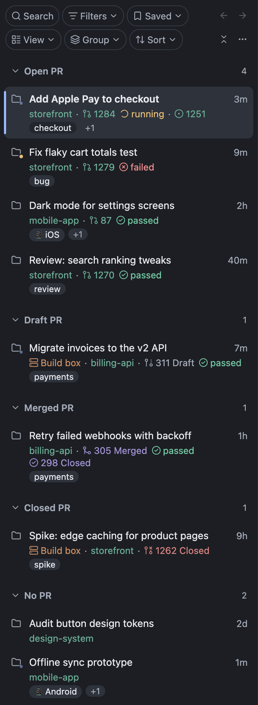
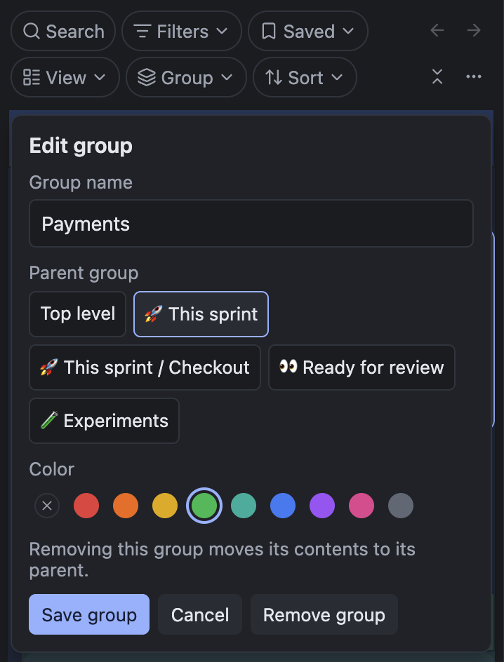
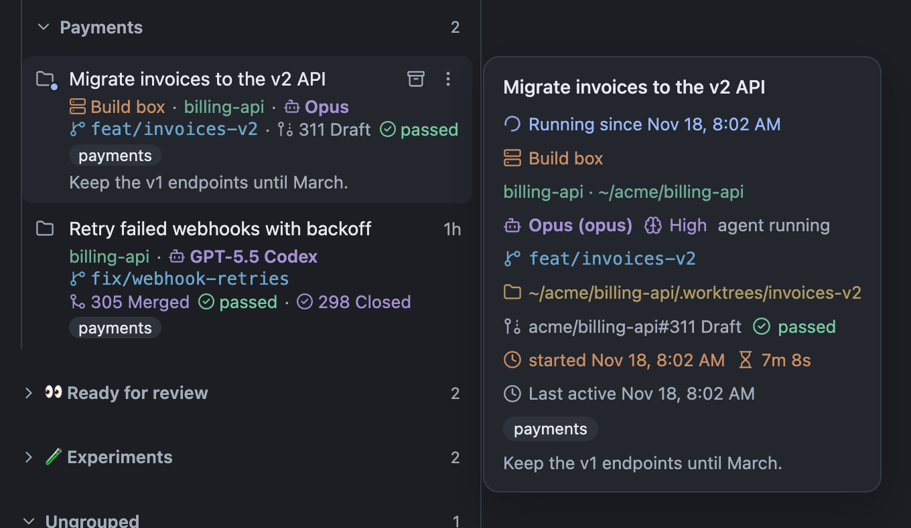
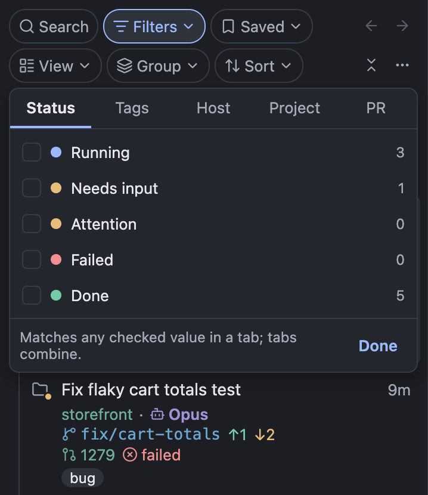
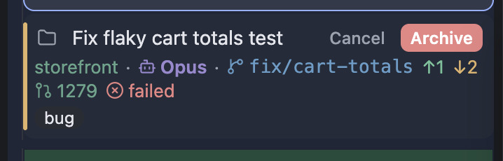
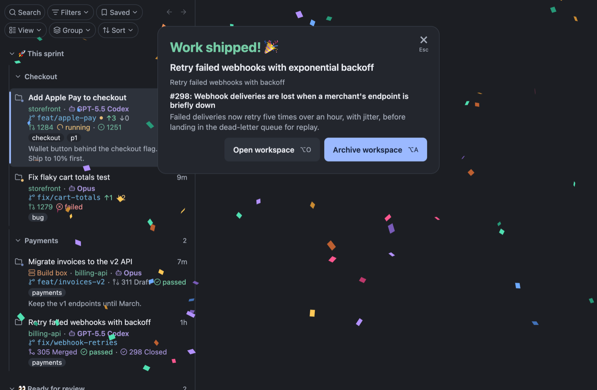

<p align="center">
  
</p>

<h1 align="center">Workspace organizer</h1>

<p align="center">
  <strong>A smarter workspace sidebar for <a href="https://paseo.sh">Paseo</a>, with confetti when your PRs merge.</strong><br>
  Group, filter and act on every agent workspace, across every host, without leaving the sidebar.
</p>

<p align="center">
  <a href="https://github.com/ajma/paseo-workspace-organizer/actions/workflows/ci.yml"></a>
  
  
  
</p>

---

<p align="center">
  
  &nbsp;
  
</p>

When you run a dozen agents at once, a flat list of workspaces stops working. **Workspace organizer** replaces Paseo's sidebar with one built for that: drag workspaces into nested groups, see each one's agent, branch, PRs and CI at a glance, find any of them by issue number in a keystroke, and archive or jump between them without hunting. And when a PR merges, it throws you a small party.

## Highlights

### 🗂️ Organize it your way
- **Nested groups, as deep as you like.** Drag workspaces into groups, drag groups into groups, and drag to reorder.
- **Pick the group up front.** Paseo's **New workspace** screen gets a **Group** field beside Host and Isolation, so a new workspace lands where it belongs.
- **Instant automatic grouping.** One click regroups everything by **Host**, **Project** or **PR status**, or shows one flat list with **None**, then back to your own groups.
- **Color-code groups.** Pick red, orange, yellow, green, teal, blue, purple, pink or gray for a group, as a tint that works in light and dark themes, on its header alone or across everything in it.
- **Collapse everything in one press**, with smooth sliding groups and **sticky headers** that stay pinned while you scroll.



### 👀 See everything at a glance



- **Rich workspace rows** show agent and model, project, branch with git status, labels in their Paseo colors, linked PRs and issues with CI results, subagents, run timer and last activity.
- **Simple, Full or Custom views.** Pick exactly which fields appear.
- **Hover for the whole story.** Rest on a row for half a second and a details panel lists every field in full, with clickable links.
- **Live status.** Running, waiting and failed rows carry a status-colored bar down their left edge; working rows glow softly and their bar pulses, CI checks spin while they run, and the open workspace is outlined. When it's scrolled out of view or inside a collapsed group, a small button at the bottom of the sidebar takes you back to it.

### 🔎 Find anything fast



- **Search by anything**: name, branch, tag, notes, group, or a PR or issue number (`#385`, `owner/repo#42`), in the sidebar or in **⌘K**.
- **Filters with live counts** for status, tags, host, project and PR state. Each option shows how many workspaces it would show.
- **Two-level tags.** `team:backend` and `📲 S25` group under `team` and `📲`.
- **Saved searches** come back with one click.

### ⚡ Move quickly



- **Back and Forward** through the workspaces you've opened, like a browser: buttons, **⌘← / ⌘→**, your mouse's side buttons, or **⌘[ / ⌘]**, which a setting takes over from Paseo's Previous and Next workspace.
- **Safe archiving.** Confirm with a red Archive button, or press **⌘⇧⌫** twice, and the row slides away.
- **Links open where you work.** PRs and issues open as a Paseo browser tab in the workspace, or in your default browser if you prefer (a setting).
- **Quick actions** in every row's ⋯ menu: edit notes, tags and links (a list with a remove button for each, issues before PRs), rename, copy path or branch, pin.

### 🎉 Celebrate shipped work



- **Confetti when a PR merges**, across the whole window, with a recap of the PR and the issues it closes.
- **Then decide**: close it, **open the workspace** (⌥O) or **archive it** (⌥A) right from the recap.
- **Your words, your confetti.** Pick the verb and emoji, hide the issue recap, or change the confetti's size, speed and amount. Reduced motion skips the falling pieces.

### 🎛️ Make it yours
- **A toolbar you arrange.** Drag the chips into any order, hide their text for an icon-only bar from the ⋯ menu, and get hover hints.
- **Sort** by manual order, recent activity, name or newest.
- **Per-device preferences** for the view, sort, grouping, collapsed groups, title lines, sticky headers and where links open.

### 🌐 Built for many hosts
- See workspaces from **every connected host** in one list, with each host's color and badge.
- **Finds PRs automatically**, from Paseo's own detection or through `gh` on the daemon machine.

## What's built in

| Area | Feature |
|---|---|
| **Groups** | Nested custom groups · group colors (header, or the whole group) · drag-and-drop workspaces and groups · Group field on the New workspace screen · Group by Host / Project / PR status / None · Ungrouped section · collapse/expand all · animated collapse · sticky group headers (setting) |
| **Rows** | Project icon or agent mark · status bar on the left edge · title (1–4 lines) · last activity · agent, model, thinking level · project › workspace · branch with dirty, ahead and behind · folder or full path · labels and tags with `+N` · PRs and issues with state, CI and review · subagent summary · run timer · notes · host badge |
| **Views** | Simple / Full / Custom views · per-field toggles · labels shown · title lines · simple rows on phones · live sample in settings |
| **Details** | Hover panel with every field in full · clickable PR and issue links · long-press on phones |
| **Search** | Text search · ⌘K Command Center results by PR or issue number · filters (status, tags, host, project, PR) with counts · two-level and emoji tags · saved searches |
| **Navigation** | Back / Forward history with ⌘← / ⌘→, ⌘[ / ⌘] and mouse side buttons · open-workspace outline · Current workspace button that scrolls to it and opens its collapsed groups · links open in a Paseo browser tab or your default browser (setting) |
| **Actions** | Archive with confirmation and slide-away animation · ⌘⇧⌫ archive shortcut · edit details · rename · copy path · copy branch · pin / unpin |
| **Toolbar** | Search · Filters · Saved · View · Group · Sort · reorderable chips · ⋯ menu with Groups from (when several hosts run it), button labels toggle and plugin settings · hover hints · two-line layout in narrow sidebars |
| **Celebrations** | Confetti and a recap when a PR merges · open or archive the workspace from the recap · ⌥O / ⌥A shortcuts · verb, emoji, issue recap and confetti settings · preview from ⌘K · desktop and web |
| **GitHub** | Paseo-detected PRs · automatic PR lookup by branch via `gh` · manual PR and issue links across repositories · bare #numbers looked up in the workspace's repository · issues named in a workspace's title or branch linked automatically · status cached and refreshed |
| **Polish** | Paseo-native look · smooth animations that respect reduced motion · per-device preferences · settings shared across clients |

See the [**user guide**](docs/guide.md) for exactly how each feature behaves.

## Quick start

1. **Check your version.** Run Paseo **0.16 or later** on both the app and the daemon.
2. **Install the plugin:**
   ```sh
   paseo plugin install npm:@ajma/paseo-workspace-organizer
   ```
   Or, from a clone of this repository: `paseo plugin install /path/to/paseo-workspace-organizer`.
3. **Switch the sidebar.** In Paseo, choose **Settings → Sidebar → Sidebar view → Workspace organizer**.

Then press **Group → New group** and start dragging workspaces in. Row fields, sticky headers and where links open live in **Settings → Plugins → Workspace organizer → Sidebar**, also reachable from the toolbar's **⋯ → Plugin settings…**. Celebrations have their own **Merge celebration** screen beside it; try one with **Preview merge celebration** in ⌘K.

> **Coming from Merge celebration?** This plugin includes it. Remove the old one (`paseo plugin remove paseo-merge-celebration`), or every merge celebrates twice. Its settings don't carry over.

> **For GitHub status**, sign in to the GitHub CLI on the daemon machine (`gh auth login`). The plugin uses your existing `gh` sign-in and never installs tools or changes credentials.

## Your data

- **Groups, notes, tags, links, saved searches and celebration settings** are stored in Paseo's settings on the installation's host, and every connected client shares them.
- **View, sort, grouping, collapsed groups, the toolbar layout, sticky headers and where links open** are saved on each device.
- The plugin **renames a workspace only when you choose Rename…**, and never changes labels, branches or files.
- **Removing the plugin** deletes its settings.

## Good to know

- **Drag and drop** works in the desktop app and on the web. On iOS and Android, use ⋯ → Edit details to move workspaces between groups.
- **Context usage and plan progress** aren't available to plugins, so rows don't show them.
- **GitHub Enterprise** links aren't supported yet.
- **Mouse side buttons** don't reach Paseo with some mice on macOS. Turn on **Back and forward with ⌘[ and ⌘]** in the plugin's Sidebar settings, then set the buttons to send ⌘[ and ⌘] in the mouse's software.
- **Merge celebrations** show on the desktop app and the web, not on phones. To archive from a celebration, turn off Paseo's automatic archiving after merge.
- **Command Center results, automatic PR lookup and merge celebrations** follow the host where the plugin is installed. Install it on each host where you want them, at the same version.
- **Groups live on one host.** With the plugin on several hosts, each keeps its own groups and the sidebar uses one host's: the only one running it, else this computer's. Switch with **⋯ → Groups from** (saved on each device; on a phone, pick the host you want).

## Development

```sh
npm ci --ignore-scripts
npm run typecheck && npm test
npm run preview          # http://127.0.0.1:5173, the real sidebar on sample data
```

GitHub Actions runs the typecheck and all unit tests on every push and pull request.

Contributing with an AI agent? Start with [CLAUDE.md](CLAUDE.md).

*Screenshots use made-up sample data: open the preview at `http://127.0.0.1:5173/?showcase` to see it, and add `&celebrate` for the celebration.*
