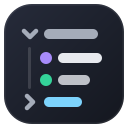

# Workspace organizer: user guide

The complete reference for every feature. For the overview, see the [README](../README.md).

## Organizing the sidebar

- **Drag and drop** organizes the sidebar in the desktop app and web. Drag a workspace onto a group's header to move it into that group, onto **Ungrouped** to take it out (Ungrouped appears while dragging even when it is empty), or above or below another workspace to place it there, in that workspace's group. A line or a highlighted header shows where it will land. Drag a group's header onto another header: the top or bottom edge puts it above or below that group, the middle nests it inside, and dropping it on Ungrouped moves it to the top level. A group cannot be dropped inside itself. Reordering workspaces needs **Sort → Manual**. With another sort, the sort decides the order: dropping a workspace anywhere on another group (a row or its header) outlines that whole group instead of drawing a line, moves the workspace in, and it appears at its sorted place; in Manual order it goes to the end of that group. iOS and Android have no drag and drop; use **Edit details** there.
- **New workspace screen**: once you have groups, Paseo's New workspace screen shows a **Group** field, styled like its Host and Isolation pickers, listing them (nested groups as paths such as `In progress / Interface`) plus **Ungrouped**. The pick travels with the new workspace, and the sidebar files it into that group as soon as it appears, then clears the pick. It only applies to brand-new workspaces, so moving one afterwards is never undone, and a group removed in the meantime leaves the workspace in Ungrouped. The sidebar does the filing, so a workspace created while no sidebar is open is filed the next time one opens.
- **Group → New group** creates a group. Hover a group's header for its **⋯** menu: **Rename or move…** (name and parent group), **Add subgroup…**, and **Remove group**, which moves its child groups and workspaces up to its parent.
- A workspace's **⋯ → Edit details** assigns its group, edits a multiline subtitle, adds comma-separated tags, and accepts one GitHub PR or issue URL per line. These editors, and the group editor, open in a popover just below the toolbar, over the list, so they show wherever the list is scrolled. Links can point to different repositories. A workspace belongs to one group, or to Ungrouped.
- The toolbar is one line of chips that wraps in a narrow sidebar. When it all fits, the icon buttons sit at the end of the line; when it doesn't, it splits in two: as many chips as fit share the first line with **Back** and **Forward**, and the rest wrap below with the collapse and ⋯ buttons at its end. The chips are: **Search**, **Filters**, **Saved**, **View**, **Group** and **Sort**. Drag a chip onto another to move it before or after it (a line shows where it will go). At the right, icon buttons go **Back** and **Forward** through the workspaces you have opened, collapse or expand every group, and **⋯** opens a menu with **Show button labels** and **Plugin settings…**; with button labels off the chips show just their icons, and resting on any icon-only chip or button for half a second names it. While a search or filter is active a **Clear** chip (✕) appears after them. The chip order and the text setting are remembered on each device. Filters, Saved, View, Group and Sort open as dropdowns over the list that fade and slide in and out (instantly when the system asks for reduced motion); Group and Sort check the current choice, and choosing one closes the menu. Opening one closes the others.
- **Group** (left of **Sort**, the two kept together at the right) groups the sidebar by **Your groups** (the default), **Host**, **Project** (with project icons) or **PR status** (Open, Draft, Merged, Closed, unknown, No PR; a workspace with several PRs sits under the most active). Automatic groups collapse like your own and can be reordered within themselves in Manual sort; your own groups stay as they are while another grouping is shown. The choice is remembered on each device.
- **Back** and **Forward** (← →) work like a browser's: every workspace you open, from the sidebar, ⌘K or anywhere in Paseo, is added to a history; Back and Forward retrace it, and opening a different workspace after going back drops the ones ahead. From a screen that isn't a workspace, such as New workspace (⌘N), Back returns to the workspace you were on. Like Chrome, **⌘←** / **⌘→** (Alt+← / Alt+→ on Windows and Linux) go back and forward, except while the cursor is in a text field or editor, where they move the cursor as usual; the mouse's back and forward side buttons work everywhere, even while typing. On macOS, **⌘[** / **⌘]** go back and forward too, even while typing (except in a code editor, where they outdent and indent). Paseo uses them for Previous and Next workspace, so first turn on **Back and forward with ⌘[ and ⌘]** in **Settings → Plugins → Workspace organizer → Sidebar**, which clears those two in Paseo's **Settings → Shortcuts** (turning it off restores them). Some mice's side buttons never reach Paseo on macOS; set them to send ⌘[ and ⌘] in the mouse's software. The buttons' hints show the shortcut. Archived workspaces are skipped. Hovering a button names the workspace it opens. The history lasts for the app session and keeps the latest 50 workspaces.
- The collapse button at the right of the toolbar collapses every group in one press, then expands them all; it works on whatever **Group** shows, and collapses while any group is open. **Ungrouped** collapses and expands like any group. Collapsed groups are remembered on each device; searching or filtering opens matching ones temporarily.
- **Sticky group headers**: while you scroll, each group's header stays at the top of the list until its workspaces have scrolled past. In the desktop app and on the web, subgroup headers pin just below their parent's; on iOS and Android each header stays until the next one pushes it up, as in the phone's own lists. It is on by default; turn it off in **Settings → Plugins → Workspace organizer → Sidebar → Groups** (saved on each device).
- The open workspace has an accent bar on its left edge, a bold title and a raised background. Clicking a workspace opens it.
- Each workspace is a row. See [Workspace rows](#workspace-rows) for its fields and settings.
- Press the search icon beside the Filters button to show the sidebar search box, or use **⌘K** / **Ctrl+K** with `#123`, `123`, `PR #123`, `issue #123`, or `owner/repo#123`. Names, branches, tags, notes and group names are searchable too. Selecting the plugin's Command Center result opens the workspace.

Paseo's detected GitHub PR is included automatically for workspaces on the installation's host and deduplicated against manually entered URLs. For workspaces on other connected hosts, the sidebar reads Paseo's detected PR, its status and git status straight from that host, so those rows show them even when the plugin is installed only here. When Paseo has not detected one for this installation's host, the plugin asks GitHub (through the daemon machine's `gh`) for the most recently updated PR of any state whose head is the workspace's branch, skipping shared branches such as `main`. Answers are cached for 10 minutes, two lookups run at a time, and a branch that was never pushed has no PR to find. Additional PRs and issues are entered manually. GitHub Enterprise URL formats are not currently supported.

Each link shows its GitHub status. PRs show Open, Draft, Merged or Closed, plus CI and review results when available. Issues show Open or Closed. Status reads use the daemon machine's installed GitHub CLI (`gh`) and its existing authentication. Sign in with `gh auth login` on that machine if necessary. The plugin does not install tools or change authentication.

Status is cached for 60 seconds and refreshed while connected, with four reads at a time per client subscription. The plugin sends configured PR/issue URLs to GitHub through `gh`; credentials stay with the CLI on the daemon machine. Paseo's detected PR status is used as a fallback. An unavailable status is labeled explicitly, and a failed refresh keeps the last known result with a stale label. The plugin does not infer issue relationships or modify PRs/issues.

The sidebar shows active workspaces across app-connected hosts using Paseo refs. Saved assignments use both host and workspace IDs. Command Center registrations and automatic PR detection follow the installation's host, as required by Paseo's command contribution scope. Install on each host where you want those features. Each installation has its own organization settings.

## Archive shortcut

Paseo's own sidebar handles **⌘⇧⌫** (Ctrl+Shift+Backspace on Windows and Linux) to archive the open workspace; this sidebar replaces it, so it handles the shortcut itself on desktop and web. Plugins cannot undo an archive, so the first press shows a reminder and a second press within five seconds archives the open workspace on whichever host it lives. Paseo's Undo (⌘Z) does not apply to archives made this way.

## Workspace rows

Each workspace is drawn as a row in the style of Paseo's own list: the project icon (or the agent's mark) with a status dot while it is running, needs input or failed (a running workspace's dot pulses, and its status ring turns like a spinner when there is no icon); the title with its last activity on the right; then the chosen fields on one line joined by "·"; labels as pills; and notes. PRs read like Paseo's list: the number, the state when not open (Draft, Merged, Closed) and the CI result (running, passed, failed); a running CI check, and a running status in the details panel, show a turning spinner. In the desktop app, clicking a PR or issue opens it as a browser tab in that workspace; elsewhere it opens in the external browser. To send desktop links to your default browser too, turn off **Open links in Paseo browser tabs** in **Settings → Plugins → Workspace organizer → Sidebar → Links** (on by default, saved on each device).

The fields are chosen in row settings. The **Host** field shows the host a workspace lives on, following each host's badge choice in Paseo (Settings → host → Appearance → Badge): Name shows the server icon and name, Icon shows the icon alone, and Hidden leaves it out. Without a choice, Paseo's default applies: this computer's own host is hidden and other hosts show their name. Host colors also come from that setting. The **View** pill in the toolbar switches the view between **Simple**, **Full** and **Custom**. The status ring and title always show; the other fields are switched in **Settings → Plugins → Workspace organizer → Sidebar** (or **⋯ → Plugin settings…** in the sidebar):

- **Agent brand mark**, **Model**, **Thinking level**: the workspace's most recently active top-level agent, named from its host's provider list. A provider without an icon shows a generic agent mark.
- **Project**, **Project icon**, **Workspace name**: shown above the title as `project › workspace`.
- **Branch** and **Git status**: uncommitted changes (a dot) and commits ahead/behind. Git status is known only for workspaces on the installation's host.
- **Folder** and **Full path**: the workspace folder, by name or as a full path with your home folder shown as `~`.
- **Labels**: native labels in their Paseo label colors, plus organizer tags. **Labels shown** limits how many appear, with `+N` for the rest.
- **Linked PRs and issues** with their GitHub status, **Notes**, **Subtask summary** (subagents running, done and failed), **Timer / finished at** (when the current run started and how long it has run, or when the last run finished and how long it took) and **Last activity** (`5m`, `3h`, in plain grey like the time in Paseo's own list).

**View** is **Simple** (host, project, one label, links and last activity), **Full** (every field, all labels) or **Custom** (your own fields and label limit, the default). Switching styles never changes your Custom fields; changing a field or **Labels shown** while on Simple or Full copies what is on screen into Custom and switches to it. A live sample row follows the switches. **Title lines** (1 to 4, or All) is saved on each device and applies to Full and Custom; Simple always shows one title line; the other row settings are shared by the installation's clients. **Use the Simple view on phones** draws Simple rows on compact layouts. **Reset rows** asks for confirmation, then restores only these settings.

Each field has its own color (project emerald, agent violet, branch sky, folder amber, subtasks teal, pull requests indigo, issues pink, timer orange; last activity stays grey); the field switches in row settings show the same colors as dots. Labels keep their Paseo label colors, and status words such as CI results keep their success, warning and danger colors.

Rest the pointer anywhere on a row for half a second to open a details panel beside the row, to its right and above the rest of the app (it moves left or up when the window is too small). It lists every field, one per line, in the same icons and colors as the row and with nothing shortened, including fields the current style hides: status and since when, project and folder, host, agent with model ID and thinking level, branch with uncommitted changes and commits ahead/behind, the full folder path, each PR or issue with its repository, state, CI and review, subagents, the current or last run, last activity, labels and notes. Moving around the same row, or from the row onto the panel, keeps it open, so you can read it and click its PRs and issues (they open like the row's links, and underline on hover); it closes when the pointer leaves both, or moves onto the archive and ⋯ buttons. On iOS and Android, long-press a field to show the same details below the row.

While the pointer is on a row, an archive button and a ⋯ menu appear at its top right. Because plugins cannot undo an archive, pressing it asks first: **Cancel** and a red **Archive** button take its place for five seconds (even if the pointer leaves the row), and only Archive archives the workspace. The row then slides away (fading, moving left and closing up) before the archive is sent; if archiving fails, the row comes back and an error message says why. With reduced motion it is archived at once. The menu's Archive… and the ⌘⇧⌫ shortcut work the same way. The menu offers Edit details (notes, tags, links and group), Copy path, Copy branch name, Pin to top or Unpin, and Archive. Tapping elsewhere on the row still opens the workspace.

Paseo does not give plugins context usage or plan progress, so rows have no context ring or plan capsule. Label colors are read from Paseo's label list on the installation's host.

## Filters, sorting and saved searches

**Sort** at the right end of the toolbar orders workspaces within each group by **Manual** (the order set by dragging), **Recent activity**, **Name**, or **Newest** (creation time). The choice is remembered on each device. Groups always keep the order they are dragged into.

The search box is hidden by default; the **Search** pill at the start of the toolbar shows or hides it beneath the toolbar. Hiding it keeps the current search text applied, and the pill stays highlighted while text is active. Recalling a saved search that contains text opens the box.

**Filters** opens a menu with **Status**, **Tags**, **Host**, **Project** and **PR** tabs and a checkbox for each value; the button and each tab show how many are selected, and **Done** closes it. Each option shows how many workspaces it would show: the count takes the search text and the other tabs' selections into account but not its own tab's selections. A tag group counts workspaces with any tag in it. The **PR** tab matches workspaces that have a PR, have one in a given state (Open, Draft, Merged, Closed), or have none. Statuses have colored dots, tags show in their Paseo label colors, and hosts show a dot in the color assigned to them in Paseo. Host colors are read from the desktop or web app's saved host list, which is not a published Paseo interface; phones show hosts without a dot. Select multiple values to match any of them within a category; categories combine together. For example, selecting Running, the review tag, and your Mac shows running review workspaces on that Mac. Tags include native workspace labels and organizer tags. Each tag group (such as `📲` or `tag`) lists its individual tags indented beneath it: check the group to match every tag in it, or check one tag to match only that tag. The project chooser shows each project's icon and adds "on <host>" only when two listed projects share a name. Icons come from the installation's host, resolved like Paseo does: the custom icon set in Paseo, otherwise a favicon, icon or logo file found in the project folder. Projects on other hosts, and SVG icons on iOS and Android, show a folder instead.

The **✕** pill (shown while a search or filter is active) clears the text and every filter. Filtering temporarily reveals matching workspaces inside collapsed groups. Selected host/project values remain selected when unavailable, producing an empty result rather than widening the search.

Two-level tags are shown as a tree in the Tags tab. Tags written as `tag:attribute`, or starting with an emoji (`📲 S25`), sit under their first level (`tag`, `📲`), which is collapsed by default; the arrow beside a group expands or collapses it. Checking a group expands it and checks every tag under it; unchecking one of those stops matching that tag, so its workspaces disappear while the rest stay. Two-level groups filter only through their sub-level tags, and the group's checkbox shows all, some (–) or none of them checked. A plain tag with nothing beneath it is a single checkbox. Matching ignores case. Emoji with skin tones, joined emoji such as `👩‍💻`, and flags count as one emoji; an emoji later in the tag has no effect. Full tags remain visible on workspace rows and searchable as text. Saved searches that selected a whole group still match every tag in it.

The **Saved** pill (a bookmark, or the name of the saved search in use) opens a dropdown like the others. It lists your saved searches, with a check beside the one in use; choosing one recalls its search text and every filter. **Save current search…** asks for a name inside the dropdown. While a recalled search is in use, **Update “name”** (shown once you change the search) replaces its criteria, and **Rename or delete “name”…** edits it; renaming keeps its saved criteria and deleting leaves your current view intact. Saved searches are live: newly matching workspaces appear automatically. They are shared through the installation's host settings and survive reloads, and saving preserves existing groups and workspace details.

## Merge celebration

When Paseo sees that a workspace's GitHub pull request has merged, confetti falls across the desktop or browser window with a recap: the PR title and excerpts from up to three issues it closes. Confetti keeps falling while the recap is open. Close it with **×** or **Esc** to keep the workspace, choose **Open workspace** (**⌥O**) to go to it, or **Archive workspace** (**⌥A**) to close the recap and archive the workspace at once; a failed archive shows its own dismissible error. Shortcuts pause while you type, and each action stops new confetti and lets the rest drift off screen. A celebration that arrives while the window is hidden waits until it is visible. With reduced motion the recap shows without falling confetti.

Only new merges celebrate: PRs already merged when the plugin starts stay quiet, as do open, closed-without-merging and unverifiable PRs. Detection follows Paseo's GitHub status refreshes and checks the merge with the GitHub CLI on the daemon machine. To choose archiving from the celebration, turn off Paseo's automatic archiving after merge. A celebration waits up to 24 hours for a desktop or browser window to show it, including across reconnects; up to 100 are held in memory, and a plugin reload or daemon restart clears them. Once shown, a celebration doesn't replay. Phones don't show celebrations.

**Settings → Plugins → Workspace organizer → Merge celebration** (or **Merge celebration settings** in ⌘K) sets:

| Setting | Choices |
|---|---|
| **Celebrate merged work** | On or off. Preview still works when it's off. |
| **Verb** | Work *shipped*, *landed*, *merged*, *committed* or *deployed* |
| **Emoji** | 🎉, 🚀, ✨, 🥳 or none |
| **Show linked issues** | Include or hide the recap of the issues the PR closes |
| **Show confetti** | Keep the recap and skip the confetti |
| **Size**, **Speed**, **Amount** | Small, medium or large pieces; a slow drift, normal fall or fast flurry; light, normal or heavy |

Changes apply at once, even to confetti already falling, and are shared by every client of the host. **Preview** on that screen, or **Preview merge celebration** in ⌘K, plays one without a merge; its workspace buttons are disabled.

## Data and behavior

Group structure, manual ordering, subtitles, plugin tags and manually entered links are stored in the installation's host settings and shared by its connected clients. The plugin also displays existing workspace labels. It does not rename workspaces or change their labels, branches or files. Collapsed groups are saved on the device; groups slide open and closed and their chevrons turn. Animations stay still when the system asks for reduced motion. Search temporarily reveals collapsed matching groups.

Settings use Paseo's revision checks. If another client changes the document while you edit, the save fails visibly and retains your draft; close the editor and reload to edit the latest version. Data survives plugin reloads and daemon restarts. Removing the plugin deletes its settings, following Paseo's settings lifecycle.

Background and archiving workspaces are hidden. Archived/deleted workspace metadata is retained in settings but does not create sidebar rows or commands.
